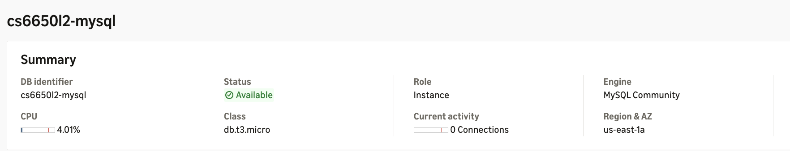
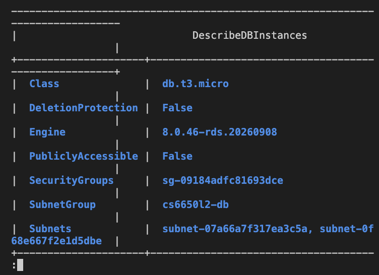
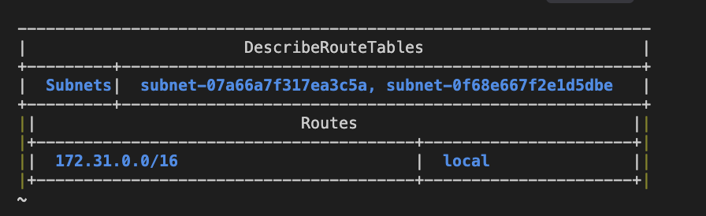
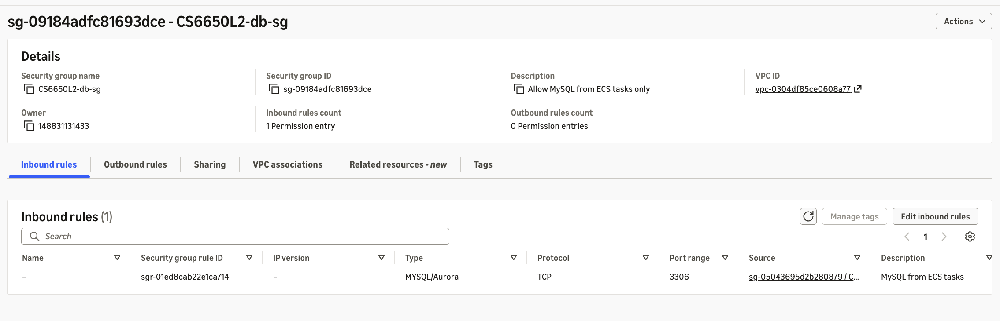
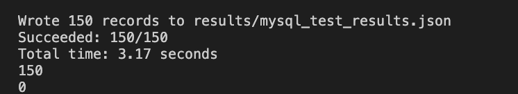
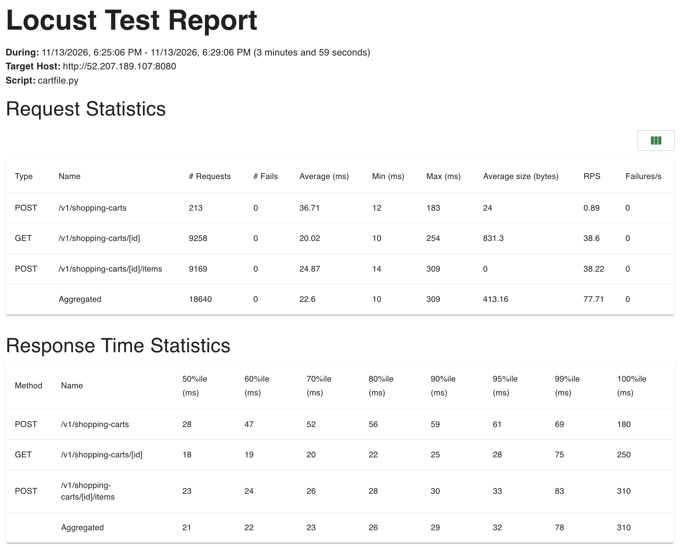
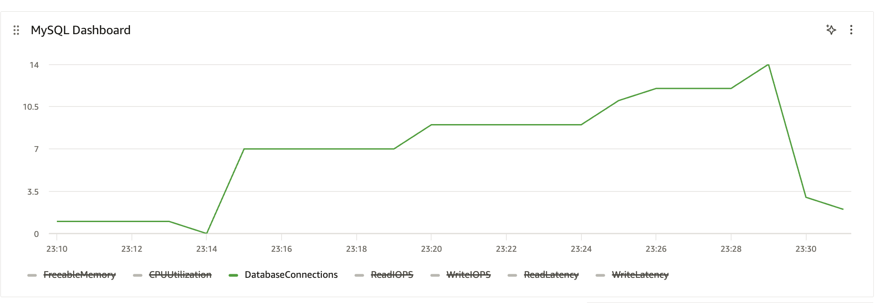
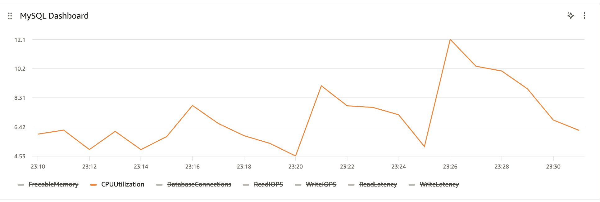

# Step I: MySQL Shopping Cart

**Contributors**

- **Milena:** relational schema design (Part 2), shopping cart API on MySQL (Part 3), required test script `loadtest/loadtest.py` (Part 4)
- **Anton:** RDS Terraform module (Part 1), ECS deployment, required 150-operation test run (Part 4), concurrent load test at 10/50/100 users, CloudWatch monitoring (Part 6)

**Environment.** Everything ran in AWS us-east-1 (Learner Lab). The API runs on ECS Fargate (1 task, 0.25 vCPU, 512 MB, no load balancer, the same single-task base as HW5) and stores carts in Amazon RDS MySQL 8.0 on db.t3.micro. The database sits in private subnets and accepts connections only from the ECS tasks' security group. The same Terraform also creates the Step II DynamoDB table, so both versions of the app can be deployed on identical infrastructure.

## Key Results

**Required 150-operation test (Part 4)**

- MySQL completed **150/150 operations** in about 3 seconds, and get cart averaged **19.6 ms**, well under the 50 ms target.
- All 150 requests averaged **21.0 ms** (p95 29.1 ms, p99 33.4 ms).

**Concurrent load (10, 50, 100 users)**

- **0 failures** in 29,904 requests across all three levels.
- Throughput grew almost tenfold (**7.9 to 77.7 req/s**) while median latency stayed flat at **20 to 21 ms**.
- The connection pool was never the limit: RDS connections peaked at **14** of the pool's **25**.

**Week 5 (in-memory) vs MySQL**

- At 50 users with the same pacing, MySQL averaged **21.3 ms** vs **18.7 ms** for the HW5 in-memory store: persistence to RDS added about **2.6 ms** per request.

## 1. Working Implementation

### 1.1 Schema design [Milena]

The cart is split into two tables linked by a foreign key ([`schema.sql`](../schema.sql)):

```sql
CREATE TABLE carts (
    id INT PRIMARY KEY AUTO_INCREMENT,
    customer_id INT NOT NULL,
    created_at TIMESTAMP NOT NULL DEFAULT CURRENT_TIMESTAMP,
    INDEX idx_customer_id (customer_id)
);

CREATE TABLE cart_items (
    cart_id INT NOT NULL,
    product_id INT NOT NULL,
    quantity INT NOT NULL,
    created_at TIMESTAMP NOT NULL DEFAULT CURRENT_TIMESTAMP,
    PRIMARY KEY (cart_id, product_id),
    FOREIGN KEY (cart_id) REFERENCES carts(id) ON DELETE CASCADE,
    CHECK (quantity > 0)
);
```

| Decision | Choice | Why |
|---|---|---|
| Tables | `carts` and `cart_items` | A cart has many items. One table would repeat the cart's info on every item row and couldn't hold an empty cart. Two tables store each fact once. |
| Cart IDs | `AUTO_INCREMENT` | The client doesn't send an ID, so MySQL generates one safely under concurrent creates. |
| Item key | Composite primary key `(cart_id, product_id)` | Each product appears only once per cart, which also enables the upsert. MySQL stores rows in primary key order, so a cart's items sit together and get cart does not need an extra index. |
| Customer lookup | Index on `customer_id` | Supports customer history queries without a full table scan. The primary keys already cover the other lookups, and every index slows down inserts. |
| Integrity | Foreign key with `ON DELETE CASCADE`, `CHECK (quantity > 0)` | Deleting a cart deletes its items, so there are no orphans. The database enforces the API's minimum quantity of 1. |

### 1.2 API [Milena]

The service implements the three cart endpoints in Go (`product-service/carts.go`, `db.go`) and uses HW5's error format.

| Endpoint | SQL | How it works |
|---|---|---|
| `POST /v1/shopping-carts` (201) | `INSERT INTO carts` | Returns the new `shopping_cart_id` from `LastInsertId()` |
| `GET /v1/shopping-carts/{id}` (200) | `carts LEFT JOIN cart_items` | One query returns the cart and its items. A LEFT JOIN keeps the cart's row even when it has no items, so an empty cart returns 200 with `"items": []`. An INNER JOIN would return no rows and make an empty cart look missing. An unknown ID returns 404. |
| `POST /v1/shopping-carts/{id}/items` (204) | Transaction: `SELECT ... FOR UPDATE`, then `INSERT ... ON DUPLICATE KEY UPDATE quantity = quantity + ?` | The SELECT checks that the cart exists (404 if not) and locks only the cart's row. Concurrent adds to the same cart wait their turn, while different carts do not block each other. The upsert adds to the quantity of an existing product instead of duplicating or overwriting it. |

- **Connection pool.** `SetMaxOpenConns(25)`, `SetMaxIdleConns(25)` and `SetConnMaxLifetime(5m)`. A db.t3.micro allows only a few dozen connections and each ECS task has its own pool, so 25 per task leaves headroom. `db.Ping()` at startup makes the service fail fast if the database is not reachable.
- **Rollback.** `defer tx.Rollback()` undoes the transaction if anything fails before commit, so a failed request doesn't leave the cart locked.
- **Tables at startup.** The app creates the tables with `CREATE TABLE IF NOT EXISTS`, which is safe on every restart.

### 1.3 Infrastructure [Anton]

The RDS module (`terraform/modules/rds/`) sits next to the existing HW5 network, ECR and ECS modules:

| Requirement | Implementation |
|---|---|
| MySQL 8.0 on db.t3.micro | `aws_db_instance`, engine `mysql` 8.0, 20 GB gp2 |
| Private subnet placement | Two new subnets in different AZs (RDS requires two) with their own route table that has only the local route, plus `publicly_accessible = false` |
| Connection from ECS tasks only | DB security group allows port 3306 only from the ECS tasks' security group |
| Skip final snapshot, no deletion protection | `skip_final_snapshot = true`, `deletion_protection = false` |

- **Credentials.** Terraform generates the password with `random_password` and passes it to the task with the host, port, user and database name as `DB_*` environment variables. The password is marked sensitive and never written to outputs or results.
- **Shared with Step II.** Both groups use the same Terraform: each store's environment variables are merged into the ECS task, and `-var app_dir=product-service` or `-var app_dir=dynamo-service` picks which app is built and deployed.



*Screenshot: `results/mysql-screenshots/console-rds-instance.png`*

The instance `cs6650l2-mysql`: Available, MySQL Community 8.0, db.t3.micro.



*Screenshot: `results/mysql-screenshots/cli-rds-network.png`*

Publicly accessible: false, the DB subnet group over the two private subnets, and the DB security group.



*Screenshot: `results/mysql-screenshots/cli-db-route-table.png`*

The DB subnets' route table has only the local route, so there is no path to or from the internet.



*Screenshot: `results/mysql-screenshots/console-db-sg-inbound.png`*

The only inbound rule: MySQL (3306) from the ECS tasks' security group.

## 2. Performance Testing Results

### 2.1 Required 150-operation test [Milena: script, Anton: run]

`loadtest/loadtest.py` runs 50 rounds of create cart, add item, get cart, one request at a time, and each round uses the cart it just created. Running these sequentially means MySQL and DynamoDB get an identical workload. A request counts as a success only if it returns the expected status code (201, 204 or 200). The script reuses one HTTP session, so the timings measure the API and database, not new connection setup. If a create fails, the round's add and get are recorded as failures, so the file always has exactly 150 records.

The run took place on 2026-11-13, 23:12:53 to 23:12:56 UTC ([`results/mysql_test_results.json`](../results/mysql_test_results.json)).

| Operation | Count | Success | Average (ms) |
|---|---|---|---|
| Create cart | 50 | 50 (201) | 21.0 |
| Add item | 50 | 50 (204) | 22.6 |
| Get cart | 50 | 50 (200) | **19.6** |
| **All 150** | **150** | **150** | **21.0** (p95 29.1, p99 33.4) |

- **Get cart is well under the 50 ms target** even with the JOIN, because the composite primary key lets MySQL read one cart's items directly.
- **Most of each number is network time.** RDS's own read and write latency stayed at 2 ms or less (2.5), so the laptop-to-AWS trip dominates.



*Screenshot: `results/mysql-screenshots/required-test-terminal.png`*

### 2.2 Concurrent load: 10, 50 and 100 users [Anton]

The required test sends one request at a time, so it can't show how the database behaves under concurrent load. A Locust scenario (`locust/cartfile.py`) runs each simulated user through its own cart: create it, add products (up to 50), and read it back, waiting 0.5 to 2 s between requests (the same pacing as the HW5 product test). `scripts/run-load.sh` ran 10, 50 and 100 users for 4 minutes each, 60 s apart, and logged each level's UTC window so CloudWatch could be matched to it ([`results/mysql-load-1/`](../results/mysql-load-1/)).

| Users | Requests | Failures | Throughput (req/s) | Average (ms) | p50 (ms) | p95 (ms) | p99 (ms) |
|---|---|---|---|---|---|---|---|
| 10 | 1,886 | 0 | 7.9 | 22.3 | 21 | 30 | 69 |
| 50 | 9,398 | 0 | 39.2 | 21.3 | 20 | 30 | 66 |
| 100 | 18,620 | 0 | 77.7 | 22.6 | 21 | 32 | 78 |

- **Latency did not change with load.** Ten times the users gave ten times the throughput at the same median.
- **Creates are slower than reads** (about 37 ms vs 20 ms average at 100 users): a create is a new row and a commit, while a get is an indexed read from memory.
- **Failure isolation.** If a create fails, the user retries the create instead of sending requests with no valid cart ID, so one failure isn't counted many times. It never triggered.



*Screenshots: `results/mysql-screenshots/locust-u10-stats.png`, `locust-u50-stats.png`, `locust-u100-stats.png` (shown), and the matching `-charts.png`*

### 2.3 Week 5 (in-memory) vs MySQL [Anton]

HW5 stored products in memory on the same single ECS task. Its 50-user FastHttpUser run used the same Locust pacing as the 50-user MySQL level:

| 50 users | HW5 in-memory (products) | HW8 MySQL (carts) | Difference |
|---|---|---|---|
| Throughput (req/s) | 39.6 | 39.2 | about the same |
| Average (ms) | 18.7 | 21.3 | +2.6 |
| p50 (ms) | 16 | 20 | +4 |
| p95 (ms) | 26 | 30 | +4 |
| p99 (ms) | 120 | 66 | −54 |
| Failures | 0 | 0 | |

- **Persistence costs a few milliseconds.** Each MySQL request adds a round trip from ECS to RDS plus the query, about 3 to 4 ms at the median.
- **Throughput is the same** because Locust's pacing, not the server, sets the request rate at 50 users.
- **The p99 difference is noise, not a MySQL advantage.** Tail latency at this load comes from the laptop's network, and the runs were weeks apart.
- **Not the same workload:** HW5 tested product GET/POST, HW8 tests the cart endpoints. The comparison shows the cost of adding a database, not a like-for-like benchmark.

### 2.4 Connection pool behavior [Anton]

The pool allows 25 open connections. RDS `DatabaseConnections` during the load test:

| Level | Connections |
|---|---|
| Idle before the test | 0 to 1 |
| 10 users | 7 |
| 50 users | 9 |
| 100 users | 12, peaking at 14 |
| After the test | dropped to 2 to 3 |

- **The pool was never exhausted.** Even at 100 users only 14 connections were open, and no request waited long enough to show in latency.
- **Few connections serve many users** because each query holds a connection for only a few milliseconds. At 77.7 req/s with a few ms of database time per request, only one or two connections are busy at any moment; the rest are idle connections the pool keeps open for bursts (`SetMaxIdleConns(25)`).
- **Where the pool would matter:** with many more users, slow queries or long transactions, requests would start queueing for a connection once all 25 are in use. That load was not reached here.



*Screenshot: `results/mysql-screenshots/cloudwatch-rds-connections.png`*

### 2.5 CloudWatch metrics [Anton]

Monitored 23:10 to 23:32 UTC, covering the required test and all three load levels:

| Metric | Result |
|---|---|
| RDS CPU | 4.5 to 12.1%; highest at the start of the 100-user level |
| RDS connections | Peak 14 of 25 (2.4) |
| RDS write IOPS | Rose with load: about 15 at 10 users, 35 at 50, 60 at 100 |
| RDS read IOPS | Near 0 (spikes of 1.5) |
| RDS read / write latency | 2 ms or less / about 0.5 ms under load |
| ECS task CPU / memory | CPU peaked about 21%; memory about 2% |

- **Reads are served from memory.** Read IOPS stayed near zero because the whole dataset fits in MySQL's buffer pool; only writes (new carts and items) reach disk, so write IOPS tracks the load.
- **No hard limit was reached.** Latency stayed flat and the pool used 14 of 25 connections at 100 users. RDS CPU (12.1% peak) was just above the db.t3.micro's 10% burstable baseline, so this load is fine in bursts, but sustained traffic at that level would draw on CPU credits (see Step III Part 2).



*Screenshots: `results/mysql-screenshots/cloudwatch-rds-cpu.png` (shown), `cloudwatch-rds-write-iops.png`, `cloudwatch-rds-read-iops.png`, `cloudwatch-rds-read-latency.png`, `cloudwatch-rds-write-latency.png`, `cloudwatch-rds-freeable-memory.png`, `cloudwatch-ecs-cpu-memory.png`*

All resources were removed afterward with `terraform destroy -auto-approve`.

### 2.6 What the results mean

- **MySQL easily meets the cart requirements** at this scale: get cart under 20 ms, 0 failures up to 100 users.
- **The database adds only a few milliseconds** over in-memory storage, and in exchange carts survive restarts and redeploys.
- **The bottleneck at higher load would be compute or the pool, not the schema.** A db.t3.micro has a fixed size; beyond what we tested, latency would rise once RDS CPU or the 25 connections ran out.

## 3. Implementation Notes

**Database schema design decisions and rationale [Milena].** Carts and items are split into two tables because every cart has a variable number of items and an empty cart has to exist before anything is added. The composite primary key `(cart_id, product_id)` allows one row per product per cart, turns "add the same product again" into a single upsert, and stores the cart's items together so get cart is a fast lookup. The only extra index is on `customer_id` for customer history queries. The foreign key with `ON DELETE CASCADE` and `CHECK (quantity > 0)` keep the data valid in the database. On the API side, a LEFT JOIN returns empty carts correctly and the add-items transaction locks only the cart being changed.

**Key challenges with MySQL integration [Anton].**

- **Default VPC subnets are not private by default.** New subnets in the default VPC use its main route table, which sends traffic to the internet gateway. The DB subnets got their own route table with only the local route.
- **Portable across regions.** We deployed in us-east-1 while Milena works in us-west-2, so the AZ lookup skips Local Zones (such as us-west-2-lax-1a, which sorts ahead of us-west-2a and may not offer db.t3.micro).
- **Sharing one Terraform with the DynamoDB group** without editing each other's code: per-store environment maps are merged into the ECS task, and `app_dir` picks which app to build.
- **Testing beyond the required script.** The 150-operation test is sequential, so a separate concurrent Locust test was needed to observe the pool and the database under load.

**Performance observations and connection pool insights [Anton].** Latency was flat from 10 to 100 users (p50 20 to 21 ms), and RDS CPU stayed under 13%. The pool peaked at 14 of 25 connections: because each query holds a connection for only a few milliseconds, a small pool serves many users. Query latency, not pool size, decides how many connections are needed until the database itself slows down.

**Brief comparison with the in-memory approach [Anton].** At 50 users, MySQL averaged 21.3 ms vs 18.7 ms for the HW5 in-memory store, about 3 ms more per request for the network hop to RDS and the query. In exchange, data survives restarts, concurrent adds are safe through row locks and transactions, and multiple app tasks could share one database, which an in-memory map per task cannot do.
