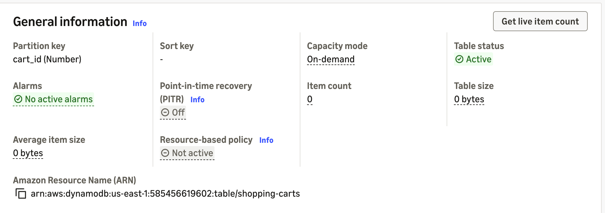
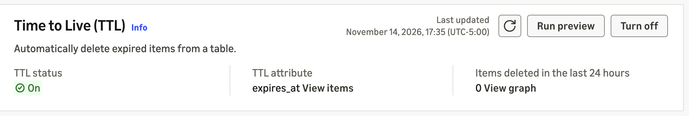
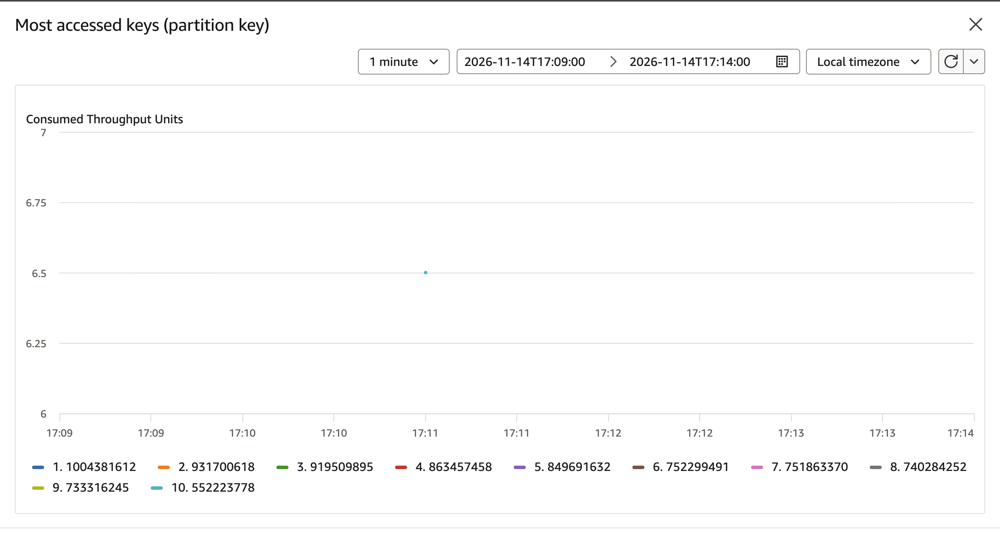
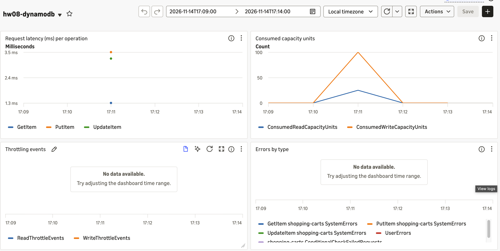

# Step II: DynamoDB Shopping Cart

**Contributors**

- **Khush:** DynamoDB table design (Part 1), Terraform and ECS deployment, consistency investigation (Part 3), CloudWatch monitoring (Part 6), same-laptop MySQL vs DynamoDB re-run
- **Dhruv:** shopping cart API on DynamoDB (Part 2), required 150-operation test (Part 4)

**Environment.** Everything ran in AWS us-east-1 (Learner Lab). The API runs on ECS Fargate (1 task, 0.25 vCPU, 512 MB) and stores carts in one DynamoDB table, `shopping-carts`. The same Terraform also creates the Step I MySQL database (RDS), so both versions of the app can be deployed on identical infrastructure. Test clients ran on teammates' laptops unless stated otherwise.

## Key Results

**Required 150-operation test (Part 4)**

- DynamoDB completed **150/150 operations**, and get cart averaged **25.2 ms**, well under the 50 ms target.
- Run from the same laptop, MySQL and DynamoDB were **nearly identical**: **47.2 ms vs 49.9 ms average**, and get cart was **43.1 vs 43.0 ms**.
- Inside DynamoDB, a request took only **1.3 to 3.5 ms** (CloudWatch). Most of each response time is the network trip between the laptop and AWS.

**Partition strategy (Part 6)**

- During the 150-op test, **50 different carts each received exactly the same load**, and there were **0 throttling events**. No partition was hot.

**Eventual consistency (Part 3)**

- Through the API: **0 stale reads in 100** read-after-write checks.
- Directly against the table: **1 stale read in 500 (0.2%)**, and it was correct on the very next read, **7.9 ms later**. With strongly consistent reads: 0 in 500.
- Strongly consistent reads cost **exactly twice** the read capacity, with no difference in speed.
- **No lost updates:** 10 clients adding to the same cart at once (100 adds) always ended at exactly 100.

## 1. Working Implementation

### 1.1 Table design [Khush]

**Starting point: the access patterns.** In DynamoDB you design the table around how the data will be read and written, not around normalizing it. The API only ever does three things, and all three are by cart ID:

| Endpoint | What it needs from the database |
|---|---|
| `POST /shopping-carts` | Save a new cart with its customer |
| `GET /shopping-carts/{id}` | Read one whole cart, with all its items, by cart ID |
| `POST /shopping-carts/{id}/items` | Add to or change the quantity of one product in one cart, by cart ID |

Every decision below follows from this.

**Partition key: `cart_id` (Number).** DynamoDB hashes the partition key to decide which storage partition holds an item, and every read or write must give that key. Since every request already has the cart ID in its URL, using `cart_id` makes every operation a direct lookup. It also spreads load evenly: each shopper works on their own cart, so requests are spread over many different keys. We considered `customer_id`, but one customer can have several carts, which would put them all on one key and mean a cart could no longer be fetched directly by its ID.

**One item per cart, items embedded as a map (no sort key).** A sort key is used to store several related items under one partition key, for example one item per product in a cart. We chose to keep the whole cart in one item instead, with its products in a map from product ID to quantity:

- **A GET is one read.** The cart is always needed in full, so splitting it into one item per product would turn every GET into a multi-item query that costs more read capacity.
- **Adding a product is one atomic update.** DynamoDB can increase one entry in a map in place (`quantity = current quantity + n`) as a single operation on a single item, so two people adding at the same time cannot overwrite each other. MySQL needed a transaction and a row lock to get the same safety.
- **It fits.** One item can be up to 400 KB; a cart with 50 products is a few KB.
- **A map, not a list.** A map entry can be updated directly by its product ID. With a list, the app would first have to read the cart to find the product's position.

Because the cart is a single item, there is no sort key.

**One table.** DynamoDB has no JOINs, so storing carts and items in two tables (like the MySQL schema) would mean two requests for every GET and no single atomic update.

**No secondary index.** A secondary index lets you look items up by a different attribute (for example all carts of a customer), but it is a hidden copy of the table that every write also has to update. None of the three endpoints looks carts up by anything other than `cart_id`, so an index would only add cost. Supporting Step I's "customer history" query would require adding an index on `customer_id`.

**On-demand capacity.** In provisioned mode you reserve a number of reads and writes per second; anything above it is throttled, and unused capacity is still paid for. In on-demand mode DynamoDB scales automatically and you pay per request. Shopping traffic is unpredictable and spiky (sales, holidays, a viral product), so on-demand avoids both throttling during spikes and paying for idle capacity during quiet hours. Provisioned would only be cheaper with steady, predictable traffic.

**Automatic expiry (TTL).** Carts are session data that are abandoned all the time. Each cart gets an `expires_at` time 7 days after creation, and DynamoDB's Time to Live feature deletes expired carts automatically at no cost, so the table does not fill up with dead carts.

**Generating cart IDs.** The API requires the cart ID to be a whole number, and DynamoDB has no auto-increment like MySQL.

- **Chosen:** a random positive 32-bit number, saved with a condition that the ID must not exist yet. If it already exists, DynamoDB refuses the write and the app retries with a new number.
- **Rejected, a counter item:** a single item incremented on every create would make every create hit the same key, which is exactly the hot partition the design must avoid.
- **Rejected, a random text ID (UUID):** it would break the API's integer ID type.

**Item format**

| Attribute | Type | Example | Purpose |
|---|---|---|---|
| `cart_id` | Number | `1840273615` | Partition key |
| `customer_id` | Number | `42` | Customer who owns the cart |
| `items` | Map | `{"7": 2, "3": 1}` | Product ID to quantity; starts empty |
| `created_at` | String | `"2026-11-13T02:00:00Z"` | Creation time |
| `expires_at` | Number | `1763600000` | Expiry time (Unix seconds) used by TTL |

Only `cart_id` is declared in the table definition. The other attributes are written by the app; DynamoDB has no fixed columns.

*Screenshot: `results/dynamodb-screenshots/dynamodb_table_overview.png`*

The deployed table: partition key `cart_id` (Number), no sort key, on-demand capacity.

*Screenshot: `results/dynamodb-screenshots/dynamodb_table_ttl.png`*

Time to Live is enabled on the `expires_at` attribute.

**How the design was validated before building the API.** The table was created in AWS and every write was tested from the AWS command line (2026-11-13):

| Check | Result |
|---|---|
| Save the same `cart_id` twice | Second write refused, so carts cannot be overwritten |
| Add product 7 with quantity 2, then 1 | Cart shows quantity 3, so adds stack correctly |
| Add to a cart that does not exist | Refused, which the API turns into a 404 |

This also revealed that `items` is a DynamoDB reserved word, so every expression has to refer to it through a placeholder (`#items`).

### 1.2 API implementation [Dhruv]

The DynamoDB version (`dynamo-service/`) implements the same three endpoints as Step I, with the same request and response bodies and error codes, using the AWS SDK for Go v2.

| Endpoint | DynamoDB operation | How it works |
|---|---|---|
| `POST /v1/shopping-carts` (201) | PutItem | Writes the new cart with the condition "this `cart_id` does not exist"; on a collision it retries with a new random ID |
| `GET /v1/shopping-carts/{id}` (200) | GetItem | Reads the cart by key, then turns the items map into a list sorted by product ID (the same response shape as MySQL) |
| `POST /v1/shopping-carts/{id}/items` (204) | UpdateItem | `SET #items.#p = if_not_exists(#items.#p, :zero) + :q` with the condition "this cart exists" |

- **Error handling.** When the "cart exists" condition fails, DynamoDB returns `ConditionalCheckFailedException`, which the API returns as **404 CART_NOT_FOUND**. Invalid input returns **400 INVALID_INPUT**, and any other SDK error returns **500 INTERNAL_ERROR**.
- **Attribute format.** DynamoDB stores every value with a type tag, for example a number is sent as the string `"42"` tagged `N`. The API converts between these typed values and Go integers in both directions, and product IDs become map keys as strings.
- **Read mode.** Whether GET uses a normal or a strongly consistent read is set by the `CONSISTENT_READ` environment variable, so the consistency tests could compare both without code changes.

### 1.3 Infrastructure [Khush]

- `terraform/modules/dynamodb/`: the table, its TTL setting, a CloudWatch dashboard and Contributor Insights
- `terraform/main.tf`: passes `DYNAMODB_TABLE`, `AWS_REGION` and `CONSISTENT_READ` to the ECS task; the Step I MySQL module stays in place for comparison
- Deploy: `terraform apply -var app_dir=dynamo-service` (add `-var consistent_read=true` for strongly consistent reads; `-var app_dir=product-service` deploys the MySQL version on the same infrastructure)

## 2. Performance Testing Results

### 2.1 Required 150-operation test compared with MySQL [Dhruv, Khush]

**What the test does.** The same script as Step I (`loadtest/loadtest.py`) runs 50 rounds of create cart, add one item, get cart, one request at a time, and records each response time and status in a JSON file.

**Required runs.** Each team ran the test once against their own deployment:

| | MySQL (Step I, Anton) | DynamoDB (Dhruv) |
|---|---|---|
| Time (UTC) | 2026-11-13 23:12:53 | 2026-11-14 22:11:17 |
| Success | 150 / 150 | 150 / 150 |
| Avg / p50 / p95 / p99 (ms) | 21.0 / 20.2 / 29.2 / 33.4 | 28.5 / 26.7 / 29.6 / 32.9 |
| Create / add / get average (ms) | 21.0 / 22.6 / 19.6 | 32.9 / 27.5 / 25.2 |

Files: `results/mysql_test_results.json`, `results/dynamodb_test_results.json`

**Problem with comparing these two runs.** The test sends one request at a time, so each response time is mostly the network trip between the laptop and AWS. These two runs came from different laptops on different networks, so the 7.5 ms difference could be the networks rather than the databases.

**Same-laptop re-run [Khush].** To remove that difference, both versions were deployed one after the other on the same infrastructure in one AWS account and tested from the same laptop, 3 minutes apart:

| | MySQL | DynamoDB |
|---|---|---|
| Time (UTC) | 2026-11-14 23:55:12 | 2026-11-14 23:58:40 |
| Success | 150 / 150 | 150 / 150 |
| Avg / p50 / p95 / p99 (ms) | 47.2 / 46.2 / 59.7 / 76.7 | 49.9 / 48.9 / 62.7 / 93.7 |
| Create / add / get average (ms) | 46.9 / 51.6 / 43.1 | 55.1 / 51.7 / 43.0 |

Files: `results/same-client/mysql_same_client.json`, `results/same-client/dynamodb_same_client.json`

- **With the network held constant, the two databases perform about the same:** 2.7 ms apart on average, and get cart is identical (43.1 vs 43.0 ms).
- **Create cart is the only noticeably slower DynamoDB operation** (55.1 vs 46.9 ms). Its average includes one slow outlier (186 ms); the reason was not investigated.
- **All times are about 20 to 25 ms higher than the required runs** because this laptop's network to AWS is slower, which confirms that the network dominates these numbers.
- **The database's own time is small.** CloudWatch measured 1.3 to 3.5 ms inside DynamoDB per request during Dhruv's run (section 2.2), against 25 to 33 ms end to end.

### 2.2 Evidence the partition strategy works under load [Khush]

**What we wanted to show.** A good partition key spreads requests evenly over many keys, so no single partition is overloaded (a hot partition) and requests are never throttled. CloudWatch was monitored during Dhruv's 150-op run (2026-11-14, 17:09 to 17:14 EST, one data point per minute).

**Contributor Insights** is a DynamoDB feature that records which partition keys receive the most traffic.

| Measurement | Result |
|---|---|
| Distinct carts accessed | **50** |
| Load on the 25 busiest carts | **Exactly the same for every cart** |
| Throttling events | **0** |
| Latency inside DynamoDB: get / create / add item | **1.29 / 3.54 / 3.26 ms** (50 requests each) |
| Capacity used: read / write units | 25 / 100 |
| System errors | 0 |

*Screenshot: `results/dynamodb-screenshots/dynamodb_contributor_insights_150op.png`*

The 10 most-accessed carts during the test. Only one dot is visible because all 10 lines sit on exactly the same value: every cart received the same load, so no key stands out as hot.

*Screenshot: `results/dynamodb-screenshots/dynamodb_dashboard_150op.png`*

The DynamoDB dashboard during the same minutes:

- **Request latency:** one point per operation at 17:11. Reads (1.3 ms) are faster than writes (3.3 to 3.5 ms).
- **Consumed capacity:** 25 read units for 50 reads (a normal read costs half a unit) and 100 write units for 50 creates plus 50 adds (one unit each). This matches the design: every request touches exactly one small item.
- **Throttling and errors:** "No data" means none occurred.

### 2.3 Eventual consistency behavior [Khush]

**Background.** DynamoDB keeps three copies of every item. A **normal (eventually consistent) read** may be answered by a copy that has not yet received the latest write, and briefly return old data: a **stale read**. A **strongly consistent read** always returns the latest data but uses twice the read capacity. The goal was to find out how often stale reads happen, how long they last, and whether they affect the shopping cart.

**Test 1: the three required scenarios through the API.** This is what a real user of the API would experience. The script (`consistency/consistency_test.py`) ran from a laptop:

- **Create then read:** create a cart and immediately GET it, 50 times. A "not found" means a stale read.
- **Add then read:** add one unit of a product to the same cart and immediately GET it, 50 times. After the 7th add the quantity must be 7; a lower number means a stale read.
- **Rapid updates from multiple clients:** 10 clients at the same time each add one unit of the same product to the same cart 10 times. The final quantity must be 100; anything lower means updates were lost.

It ran once with normal reads and once with strongly consistent reads (the app redeployed with `CONSISTENT_READ=true`):

| | Normal reads (2026-11-14 22:18 UTC) | Strong reads (22:45 UTC) |
|---|---|---|
| Create then read: stale | 0 / 50 | 0 / 50 |
| Add then read: stale | 0 / 50 | 0 / 50 |
| 10 clients x 10 adds: final quantity | 100 / 100, 0 lost | 100 / 100, 0 lost |
| Read capacity used (CloudWatch) | 52 units for 104 reads | 105 units for about 105 reads |

**Why a second test was needed.** Test 1 saw no stale reads at all. A copy that is behind usually catches up within milliseconds, while each request from the laptop takes about 25 to 55 ms to reach AWS. By the time the read arrived, the copies had already caught up, so Test 1 could not show how often stale reads actually occur.

**Test 2: directly against the table from inside AWS.** To read as soon as possible after each write, a second script (`consistency/direct_consistency_test.py`) skipped the API and ran in AWS CloudShell, a terminal running in AWS. It made 500 write-then-read checks of each kind:

- **New cart then read:** save a new cart and immediately read it.
- **Update then read:** add one unit to a cart and immediately read the quantity.

When a read was stale, the script kept re-reading until the data appeared and recorded how long that took. CloudShell turned out to need about 190 ms per request, slower than expected, but it still caught a stale read:

| | Normal reads (23:03 to 23:10 UTC) | Strong reads (23:11 to 23:18 UTC) |
|---|---|---|
| New cart then read: stale | **1 / 500 (0.2%)** | 0 / 500 |
| Update then read: stale | 0 / 500 | 0 / 500 |
| Time until the stale read was correct | **Next read, 7.9 ms later** | Not applicable |

The strong-read run is the control: it must show 0, which confirms the test only flags real stale reads.

**What this means for the shopping cart**

- **Stale reads are real but rare and very short:** 1 in 500 normal reads right after a write, gone within 8 ms, and none at all through the API.
- **The case that showed it was reading a brand-new cart.** A user creating a cart and opening it immediately could, very rarely, get "not found" for a few milliseconds. A retry or a strongly consistent read for that one request removes the risk.
- **Strongly consistent reads are a direct trade:** no stale reads and no slower, but twice the read cost.
- **Concurrent updates are always safe.** Every add is a single atomic update of one item, so 10 clients updating the same cart at once never lost an update. This holds regardless of read mode.

Files: `consistency/results/dynamo-eventual.json`, `dynamo-strong.json`, `direct-eventual.json`, `direct-strong.json`

## 3. Implementation Notes [Khush]

**Partition key strategy and rationale.** Every access pattern (create, get, add item) is by cart ID, so `cart_id` is the partition key and every request is a direct lookup of one item. Because DynamoDB hashes the key and each shopper uses their own cart, traffic spreads evenly across partitions. Contributor Insights confirmed this during the 150-op test: 50 carts, identical load per cart, 0 throttling. The one place a hot key could have appeared, generating cart IDs, was handled with random IDs and a conditional write instead of a shared counter.

**Key differences from the MySQL implementation (Step I)**

| | MySQL (Step I) | DynamoDB (Step II) |
|---|---|---|
| Data layout | `carts` and `cart_items` tables linked by a foreign key | One item per cart, products embedded as a map |
| Get cart | JOIN across two tables | One GetItem by key |
| Safe concurrent add | Transaction with `SELECT ... FOR UPDATE` row lock | One atomic UpdateItem, no lock |
| Cart IDs | `AUTO_INCREMENT` | Random number plus "only if new" condition |
| Customer history | Index on `customer_id` | Would need a secondary index (not built) |
| Connections | Connection pool to configure (25 connections) | HTTPS requests through the AWS SDK; no pool to size |
| Capacity | Fixed instance size (db.t3.micro) | On-demand, scales automatically, billed per request |
| Network setup | Database in private subnets, security group from ECS only | Public AWS endpoint, access controlled by IAM role |

**Eventual consistency observations.** Normal reads can return old data for a few milliseconds after a write. We measured it once in 500 direct reads (a just-created cart briefly not found) and never through the API, where network delay gives the copies time to catch up. For a shopping cart this is acceptable. Where reading your own write matters, the application can use a strongly consistent read for that request at twice the read cost, or retry a "not found" once.

**NoSQL vs SQL trade-offs discovered**

- **The design is locked to the access patterns.** DynamoDB is fast and simple for "everything by cart ID", but every new kind of query (carts by customer, carts containing a product) needs a new index or a full table scan. MySQL can answer a new question with a new SQL query on the existing tables.
- **Performance was a tie for this workload.** From the same laptop, both averaged under 50 ms and differed by 2.7 ms; the network mattered far more than the database choice.
- **Data integrity moves into the application.** DynamoDB has no foreign keys and no column types beyond the key. Embedding items in the cart removes the orphaned-item problem, but the app is responsible for writing the right item shape.
- **Embedding only works for bounded data.** A cart of 50 products fits easily in one 400 KB item; unbounded lists (for example a customer's full order history) would need separate items under a sort key.
- **Less to operate.** There was no connection pool to tune, no instance size to choose and no private networking for the database, and capacity scaled by itself. The trade-off is cost per request instead of a fixed hourly price.
